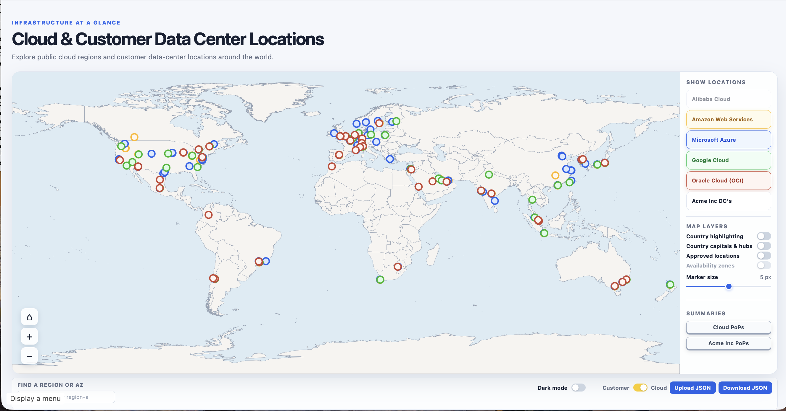
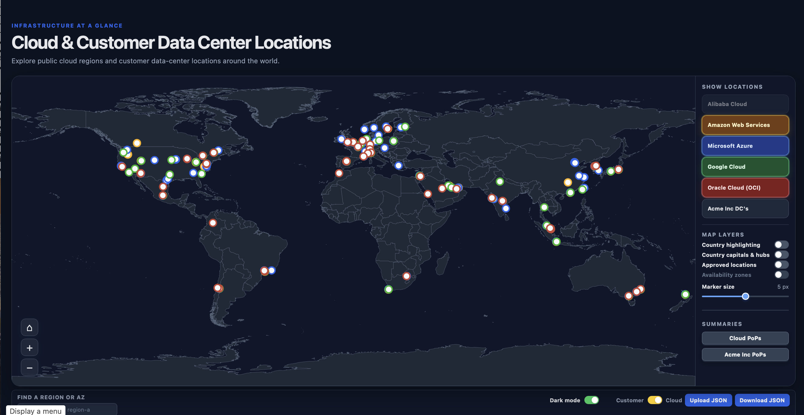

# Cloud & Customer Data Center Locations
Plots the locations of the Cloud Vendor DataCenters

Displays cloud data-center locations with native SVG rendering and published source data.

The map boundaries are bundled in `data/ref/world-countries.geojson` from the public
[geo-countries dataset](https://github.com/datasets/geo-countries), allowing country outlines and location markers
to use the same geographic coordinate system.

Example screenshots.



OCI records use Oracle's region identifiers and approximate city coordinates from the
[OCI regions documentation](https://docs.oracle.com/en-us/iaas/Content/General/Concepts/regions.htm).
Exact physical data-center coordinates are not generally public, so markers represent the
provider region's named location.

City mode includes country capitals plus reference hubs for New York, San Francisco, and
Seattle. These hub markers are city references and are not provider-region claims.

## Location data

Run `node scripts/refresh-locations.js` to rebuild `data/locations.csp.json`. The refresh process
loads the current OCI region tables from Oracle documentation, including commercial, sovereign, and government
realms; if Oracle is unavailable, it preserves the last generated OCI set as a fallback.
For the in-app `Download JSON` action to refresh the merge first, run
`node scripts/local-server.js` and open `http://127.0.0.1:8765/`. The button downloads
the refreshed merged JSON; use `Upload JSON` afterward to load it into the map.

To run the local server over HTTPS, create a self-signed development certificate once:

```bash
./scripts/create-local-cert.sh
node scripts/local-server.js --https
```

Then open `https://127.0.0.1:8765/`. The browser will show a certificate warning because
the certificate is self-signed; accept it for local development only. Certificate files are
stored in `.certs/` and excluded from Git.
The canonical non-OCI provider records are stored in `data/ref/locations.source.json`.
Provider records are normalized from that source data, while company-maintained fields
belong in `data/ref/locations.manual.json`. Manual entries are keyed by `provider:regionId`
and are merged without being overwritten. This supports fields such as `dataCenterAddress`,
`companyAccessStatus`, and private-cloud Alibaba locations.

For private customer data, use `data/locations.customer.json`. This file is excluded from
Git and is loaded by the browser after `data/locations.csp.json` at runtime. Set your
company name once in `customerName`, then add Customer DC records in the `locations` array. The
company name is used for the filter button and customer-location hover labels. The file may be absent
or empty without affecting the public dataset. A customer record with the same `regionId` replaces
the generated record with that key; otherwise it is appended. Use the Customer/Cloud slider beside
the Upload JSON and Download JSON buttons to choose which dataset those buttons operate on. When
served by `scripts/local-server.js`, uploads overwrite the selected JSON file on disk; downloads
read the current selected file. The server must be running for uploads to work.

### JSON format

The uploaded file must contain a non-empty JSON array. Each location object must include:

- `provider` (or the legacy `csp`) — `AWS`, `Azure`, `GCP`, `ALI`, `OCI`, or `CUSTOMER`
- `regionId` (or the legacy `code`) — a unique identifier for the location
- `coordinates` with numeric `lat` and `lon` values, or a legacy `coord` string in `"lat,lon"` format

These fields are recommended but optional: `regionName`, `location`, `country`, `status`,
`dataCenterAddress`, `sourceUrl`, `lastVerified`, and `companyAccessStatus`.

To mark a region as approved for your company, add `"companyAccessStatus": "enabled"`
to that location. The **Approved locations** map-layer filter matches this exact value and
hides locations that are missing it or use any other value. The same field can be added to
an item in `availabilityZones` when an individual availability zone is approved.
Records with `provider: "CUSTOMER"` are treated as approved automatically, so Customer DC
locations do not need `companyAccessStatus`.

For customer data centers, set `provider` to exactly `"CUSTOMER"`. The map groups those records
under the company-specific DC filter. The loader also accepts `"Customer DC's"` as a provider value
and normalizes it to `"CUSTOMER"`. Customer records use the same coordinate and optional fields
as cloud-provider records; `regionId` can be any stable identifier that is meaningful to your organization.

The smallest valid record is:

```json
{
  "provider": "CUSTOMER",
  "regionId": "customer-london-1",
  "coordinates": { "lat": 51.5072, "lon": -0.1276 }
}
```

The private customer file uses this wrapper format:

```json
{
  "customerName": "Example Corp",
  "locations": [
    {
      "provider": "CUSTOMER",
      "regionId": "customer-london-1",
      "location": "London",
      "country": "United Kingdom",
      "companyAccessStatus": "enabled",
      "coordinates": { "lat": 51.5072, "lon": -0.1276 }
    }
  ]
}
```

The same `locations.customer.json` file can also contain approval overlays for
cloud regions. An overlay only needs the provider, the matching region ID, and
`companyAccessStatus`; at load time it is merged onto the full cloud record from
`locations.csp.json`:

```json
{
  "customerName": "Example Corp",
  "locations": [
    { "provider": "OCI", "regionId": "uk-london-1", "companyAccessStatus": "enabled" },
    { "provider": "AWS", "regionId": "eu-west-2", "companyAccessStatus": "disabled" }
  ]
}
```

Use `"enabled"` to make a cloud location appear when **Approved locations** is
enabled. Use another value, or omit the field, to leave it unapproved. Overlay
records must match an existing provider and region ID; full Customer DC records
still require coordinates and are appended to the merged dataset.
An approval-only overlay with no matching CSP record is skipped; it cannot create
a new map location without full coordinates.

For an individual availability zone, include the overlay inside the matching
region record. The region's full record remains in `locations.csp.json`; only
the approval field needs to be supplied in the customer file:

```json
{
  "provider": "OCI",
  "regionId": "uk-london-1",
  "availabilityZones": [
    {
      "id": "uk-london-1-ad-1",
      "companyAccessStatus": "enabled"
    }
  ]
}
```

The availability-zone ID must match the corresponding zone in the full CSP
record. The **Approved locations** filter includes that AZ when its value is
exactly `"enabled"`.

Availability-zone locations can be recorded within a region using an `availabilityZones` array. Each zone may
include `id` or `name`, `coordinates` (`lat` and `lon`), `location`, `dataCenterAddress`, and
`companyAccessStatus`. AZ markers are shown with the `AZ Locations` control when coordinates are available.

Example manual override:

```json
{
  "GCP:europe-west2": {
    "availabilityZones": [
      {
        "id": "europe-west2-a",
        "name": "europe-west2-a",
        "location": "London",
        "coordinates": { "lat": 51.5072, "lon": -0.1276 },
        "dataCenterAddress": "",
        "companyAccessStatus": "enabled"
      }
    ]
  }
}
```
