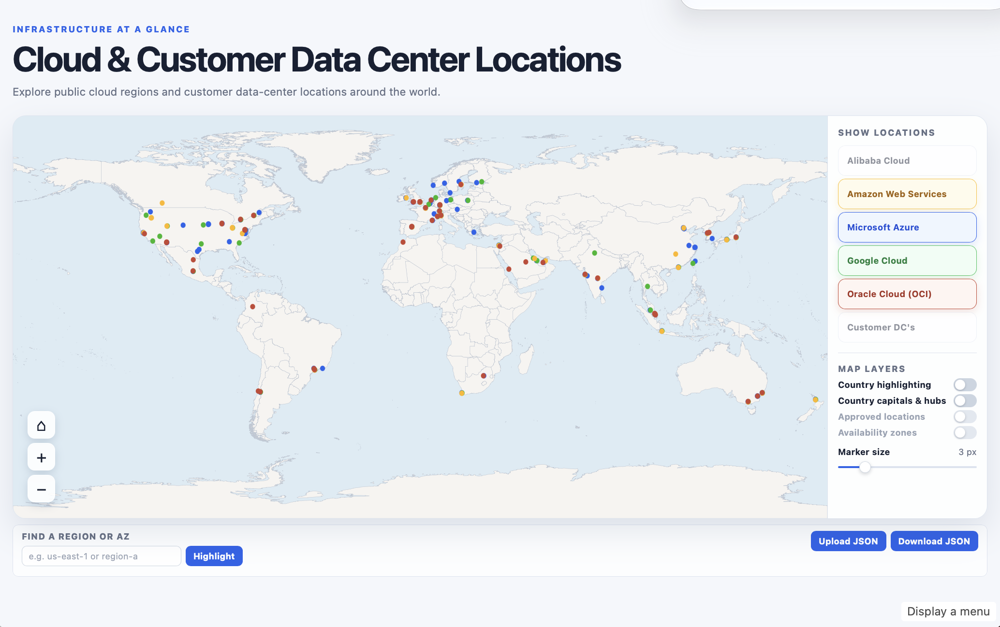

# Cloud & Customer Data Center Locations
Plots the locations of the Cloud Vendor DataCenters

Displays cloud data-center locations with native SVG rendering and published source data.

The map boundaries are bundled in `data/world-countries.geojson` from the public
[geo-countries dataset](https://github.com/datasets/geo-countries), allowing country outlines and location markers
to use the same geographic coordinate system.

Example screenshot.


OCI records use Oracle's region identifiers and approximate city coordinates from the
[OCI regions documentation](https://docs.oracle.com/en-us/iaas/Content/General/Concepts/regions.htm).
Exact physical data-center coordinates are not generally public, so markers represent the
provider region's named location.

City mode includes country capitals plus reference hubs for New York, San Francisco, and
Seattle. These hub markers are city references and are not provider-region claims.

## Location data

Run `node scripts/refresh-locations.js` to rebuild `data/provider-locations.generated.json`. The refresh process
loads the current OCI region tables from Oracle documentation, including commercial, sovereign, and government
realms; if Oracle is unavailable, it preserves the last generated OCI set as a fallback.
For the in-app `Download JSON` action to refresh the merge first, run
`node scripts/local-server.js` and open `http://127.0.0.1:8765/`. The button downloads
the refreshed merged JSON; use `Upload JSON` afterward to load it into the map.
Provider records are normalized from the current source data, while company-maintained fields
belong in `data/provider-locations.manual.json`. Manual entries are keyed by `provider:regionId`
and are merged without being overwritten. This supports fields such as `dataCenterAddress`,
`companyAccessStatus`, and private-cloud Alibaba locations.

### JSON format

The uploaded file must contain a non-empty JSON array. Each location object must include:

- `provider` (or the legacy `csp`) — `AWS`, `Azure`, `GCP`, `ALI`, `OCI`, or `CUSTOMER`
- `regionId` (or the legacy `code`) — a unique identifier for the location
- `coordinates` with numeric `lat` and `lon` values, or a legacy `coord` string in `"lat,lon"` format

These fields are recommended but optional: `regionName`, `location`, `country`, `status`,
`dataCenterAddress`, `sourceUrl`, `lastVerified`, and `companyAccessStatus`.

For customer data centers, set `provider` to exactly `"CUSTOMER"`. The map groups those records
under the `Customer DC's` filter. The loader also accepts `"Customer DC's"` as a provider value
and normalizes it to `"CUSTOMER"`. Customer records use the same coordinate and optional fields
as cloud-provider records; `regionId` can be any stable identifier that is meaningful to your organization.

The smallest valid record is:

```json
{
  "provider": "CUSTOMER",
  "regionId": "customer-london-1",
  "coordinates": { "lat": 51.5072, "lon": -0.1276 }
}
```

Availability-zone locations can be recorded within a region using an `availabilityZones` array. Each zone may
include `id` or `name`, `coordinates` (`lat` and `lon`), `location`, `dataCenterAddress`, and
`companyAccessStatus`. AZ markers are shown with the `AZ Locations` control when coordinates are available.

Example manual override:

```json
{
  "GCP:europe-west2": {
    "availabilityZones": [
      {
        "id": "europe-west2-a",
        "name": "europe-west2-a",
        "location": "London",
        "coordinates": { "lat": 51.5072, "lon": -0.1276 },
        "dataCenterAddress": "",
        "companyAccessStatus": "enabled"
      }
    ]
  }
}
```
